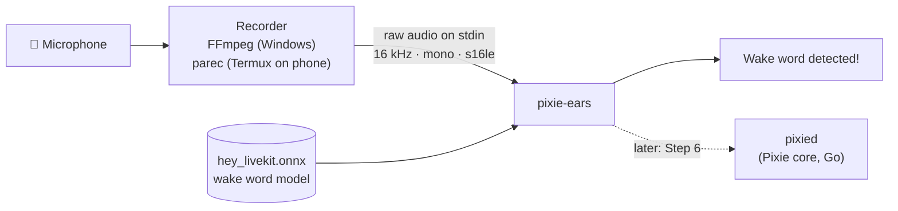

# pixie-ears 👂
 
**The ears of Pixie**: a small Rust program that listens to raw audio and, step by step, learns to hear the wake word **"Hey Pixie"**.
 
pixie-ears is part of **Project Pixie**, an open-source desk buddy robot.
 
> **Status:** Step 2 done. pixie-ears now runs a ready-made wake word model and detects **"Hey LiveKit"** live from the microphone. Training our own **"Hey Pixie"** model is next (Step 3).
 
---
 
## What it does today
 
pixie-ears reads raw audio from **stdin**, gives every 80 ms of it to a wake word model, and gets back a **score from 0 to 1**. When someone says **"Hey LiveKit"** and the score goes above **0.5**, it prints:
 
```
Wake word detected!
```
 
Then it clears the model's memory and keeps listening.
 
---
 
## How it fits together
 
pixie-ears **never talks to the microphone itself**. Another program (a "recorder") captures the mic and pipes raw audio into it. This keeps pixie-ears the same on Windows, Linux and Android.
 

 
The model is a **separate file**, loaded when the program starts. Changing the wake word means swapping the `.onnx` file. The Rust code doesn't need to change.
 
### Audio format (required)
 
| Setting | Value | Why |
| --- | --- | --- |
| Sample rate | 16,000 Hz | What the wake word model is trained on |
| Channels | 1 (mono) | One mic is enough for speech |
| Sample format | `s16le`: signed 16-bit, little-endian | Each sample is 2 bytes, low byte first |
 
Any other format gives wrong numbers. The recorder must convert to this format.
 
---
 
## How it works (in simple words)
 
1. **Load the model once.** At startup, pixie-ears opens `hey_livekit.onnx` and tells it the audio is 16,000 Hz.
2. **Read a chunk.** Wait until exactly 2560 bytes have arrived.
   2560 bytes ÷ 2 bytes per sample = **1280 samples** = **80 ms** of audio at 16 kHz.
   80 ms is the step size the model was trained on: one chunk = one model step.
3. **Turn bytes into numbers.** Every 2 bytes become one `i16` sample (from −32768 to 32767).
4. **Score it.** Give the 1280 samples to the model. It remembers the chunks before, so it can "hear" a whole phrase over many chunks, and returns a score for `hey_livekit`.
5. **Decide.** If the score is above **0.5**, print `Wake word detected!` and **reset** the model's memory so it starts fresh.
6. **Repeat** until the audio stream ends.
```
bytes:    [lo hi][lo hi][lo hi] ... (2560 bytes)
samples:   s0     s1     s2     ... (1280 samples = 80 ms)
model:    samples ──► mel picture ──► streaming model (has memory) ──► score 0..1
decide:   score > 0.5 ?  ──► "Wake word detected!" + reset
```
 
"Hey LiveKit" takes about 0.6 to 0.8 seconds to say, so the model sees it across roughly 8 to 10 chunks before it is sure.
 
---
 
## Requirements
 
| Tool | Where | Used for |
| --- | --- | --- |
| [Rust](https://www.rust-lang.org/tools/install) (stable) | Laptop and phone | Building pixie-ears |
| [FFmpeg](https://ffmpeg.org/download.html) | Windows / Linux / macOS | Capturing the mic and converting audio |
| [Termux](https://termux.dev/) + `pulseaudio` | Android phone | Capturing the mic with `parec` |
| [livekit-wakeword](https://crates.io/crates/livekit-wakeword) crate `0.2` | Added by Cargo | Runs the wake word model (pure Rust, no extra libraries) |
 
---
 
## Get the wake word model
 
The model file is **not** stored in this repo. Download the ready-made "hey livekit" model into the project folder (next to `Cargo.toml`):
 
```bash
curl -L -o hey_livekit.onnx https://github.com/livekit/livekit-wakeword/raw/v2.1.3/models/hey_livekit.onnx
```
 
- The file should be **7,406,178 bytes**.
- It must be a **v2 (streaming)** model. Old v1 models (about 950 KB, from older tutorials) will not load.
- Keep the name `hey_livekit.onnx`. The program looks up the score by the file name, so renaming the file breaks the lookup.
- The path is relative, so **run pixie-ears from the project folder**.
---
 
## Build
 
```bash
git clone https://github.com/<your-username>/pixie-ears.git
cd pixie-ears
cargo build --release
```
 
The program ends up at `target/release/pixie-ears` (or `pixie-ears.exe` on Windows).
 
The first build takes a few minutes because it compiles the model engine. Always use `--release`, because a debug build runs the model much slower.
 
---
 
## Run on Windows (FFmpeg)
 
> **Use Command Prompt (cmd), not Windows PowerShell 5.** Old PowerShell treats piped data as text and corrupts raw audio. PowerShell 7.4+ also works.
 
**1. Find your microphone's name:**
 
```bat
ffmpeg -hide_banner -list_devices true -f dshow -i dummy
```
 
Look for a line like `"Microphone Array (Realtek(R) Audio)" (audio)`.
 
**2. Pipe the mic into pixie-ears:**
 
```bat
ffmpeg -hide_banner -loglevel error -f dshow -i audio="Microphone Array (Realtek(R) Audio)" -ac 1 -ar 16000 -f s16le - | target\release\pixie-ears.exe
```
 
Say **"Hey LiveKit"** and watch for `Wake word detected!`. Press `Ctrl+C` to stop.
 
---
 
## Run on Linux / macOS (FFmpeg)
 
```bash
# Linux (PulseAudio / PipeWire)
ffmpeg -hide_banner -loglevel error -f pulse -i default -ac 1 -ar 16000 -f s16le - | ./target/release/pixie-ears
 
# macOS (":0" = first audio input; list devices with: ffmpeg -f avfoundation -list_devices true -i "")
ffmpeg -hide_banner -loglevel error -f avfoundation -i ":0" -ac 1 -ar 16000 -f s16le - | ./target/release/pixie-ears
```
 
---
 
## Run on the phone (Termux)
 
> Not tested on the phone yet. This is planned for Step 5.
 
**1. Install tools inside Termux:**
 
```bash
pkg update
pkg install rust git pulseaudio
```
 
**2. Allow the microphone:** in Android Settings → Apps → Termux → Permissions → Microphone → Allow.
 
**3. Start PulseAudio with the Android mic source:**
 
```bash
pulseaudio --start --load="module-sles-source" --exit-idle-time=-1
```
 
**4. Get the model, build and run:**
 
```bash
curl -L -o hey_livekit.onnx https://github.com/livekit/livekit-wakeword/raw/v2.1.3/models/hey_livekit.onnx
cargo build --release
parec --format=s16le --rate=16000 --channels=1 | ./target/release/pixie-ears
```
 
---
 
## Test without a microphone
 
FFmpeg can generate sounds that should **not** wake Pixie. This is a quick check that the program runs without false alarms:
 
```bash
# 3 seconds of a 440 Hz beep (no wake expected)
ffmpeg -hide_banner -loglevel error -f lavfi -i "sine=frequency=440:duration=3" -ac 1 -ar 16000 -f s16le - | cargo run --release
 
# 3 seconds of silence (no wake expected)
ffmpeg -hide_banner -loglevel error -f lavfi -i "anullsrc=r=16000:cl=mono" -t 3 -f s16le - | cargo run --release
```
 
To test a real detection, record yourself saying "Hey LiveKit" and play the file through it:
 
```bash
ffmpeg -hide_banner -loglevel error -i my-voice.wav -ac 1 -ar 16000 -f s16le - | cargo run --release
```
 
---
 
## Settings
 
These are set in `src/main.rs`:
 
| Setting | Default | What it changes |
| --- | --- | --- |
| `BUCKET_SIZE` | `2560` | Bytes per chunk (2560 = 80 ms = one model step). Keep it even. |
| Model file | `hey_livekit.onnx` | Which wake word to listen for |
| Threshold | `0.5` | Higher = fewer false wakes but may miss quiet calls; lower = the opposite. LiveKit tuned 0.5 to about 0.5 false alarms per hour. |
 
---
 
## Roadmap
 
- [x] **Step 0:** Install tools (Rust, FFmpeg, Termux)
- [x] **Step 1:** Live volume meter from raw PCM on stdin (read, chunk, RMS loudness)
- [x] **Step 2:** Run the pre-trained **"Hey LiveKit"** model (LiveKit WakeWord v2, streaming ONNX) from Rust
- [ ] **Step 3:** Train a custom **"Hey Pixie"** model (synthetic voices + negative samples) and swap the `.onnx` file
- [ ] **Step 4:** Detection rules: cooldown after a wake, mute while Pixie speaks, fewer false triggers
- [ ] **Step 5:** Run it on the phone, 24/7
- [ ] **Step 6:** Send wake events to `pixied` (Pixie's core)
The wake word is meant to respond to **anyone** who says "Hey Pixie", not only one person.
 
---
 
## Part of Project Pixie
 
| Component | Language | Job |
| --- | --- | --- |
| **pixie-ears** (this repo) | Rust | Listening and the wake word |
| pixied | Go | Core: commands, devices, routing |
| Brain | llama.cpp + small local model | Understanding requests |
| Face | React | Animated eyes and emotions |
 
---
 
## Credits
 
- Wake word engine and the "hey livekit" model: [LiveKit WakeWord](https://github.com/livekit/livekit-wakeword) (Apache-2.0).
## License
 
To be decided. Pixie is planned to be open source.
 