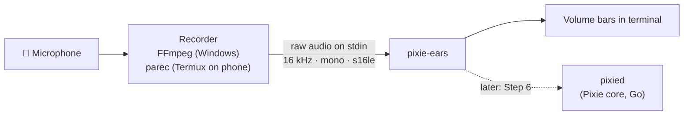

# pixie-ears 👂

**The ears of Pixie**: a small Rust program that listens to raw audio and, step by step, learns to hear the wake word **"Hey Pixie"**.

pixie-ears is part of **Project Pixie**, an open-source desk buddy robot.

> **Status:** Step 1 done. pixie-ears currently works as a **live volume meter**. Wake word detection is coming in Steps 2 and 3.

---

## What it does today

pixie-ears reads raw audio from **stdin** and prints how loud each 80 ms slice of sound is, with a bar:

```
    1     12 :
    2     15 :
    3   1830 : #########
    4   4210 : #####################
    5    960 : ####
    6     20 :
```

| Column | Meaning |
| --- | --- |
| 1st | Chunk number (one chunk = 80 ms of audio) |
| 2nd | Loudness of that chunk (RMS value, 0 to 32767) |
| 3rd | A bar: one `#` for every 200 units of loudness (max 60) |

---

## How it fits together

pixie-ears **never talks to the microphone itself**. Another program (a "recorder") captures the mic and pipes raw audio into it. This keeps pixie-ears the same on Windows, Linux and Android.



### Audio format (required)

| Setting | Value | Why |
| --- | --- | --- |
| Sample rate | 16,000 Hz | Standard for speech and wake word models |
| Channels | 1 (mono) | One mic is enough for speech |
| Sample format | `s16le`: signed 16-bit, little-endian | Each sample is 2 bytes, low byte first |

Any other format will give wrong numbers. The recorder must convert to this format.

---

## How it works (in simple words)

1. **Read a chunk.** Wait until exactly 2560 bytes have arrived.
   2560 bytes ÷ 2 bytes per sample = **1280 samples** = **80 ms** of audio at 16 kHz.
2. **Turn bytes into numbers.** Every 2 bytes become one `i16` sample (from −32768 to 32767).
3. **Measure loudness with RMS** (Root Mean Square):
   - **Square** every sample, so negative and positive parts of the wave don't cancel out
   - Take the **mean** (average) of the squares
   - Take the square **root** to get back to the normal scale
4. **Draw a bar.** Divide the RMS by 200 and print that many `#`.
5. **Repeat** until the audio stream ends.

```
bytes:    [lo hi][lo hi][lo hi] ... (2560 bytes)
samples:   s0     s1     s2     ... (1280 samples)
RMS:      sqrt( (s0² + s1² + ... + s1279²) / 1280 )
bar:      "#" × min(RMS / 200, 60)
```

---

## Requirements

| Tool | Where | Used for |
| --- | --- | --- |
| [Rust](https://www.rust-lang.org/tools/install) (stable) | Laptop and phone | Building pixie-ears |
| [FFmpeg](https://ffmpeg.org/download.html) | Windows / Linux / macOS | Capturing the mic and converting audio |
| [Termux](https://termux.dev/) + `pulseaudio` | Android phone | Capturing the mic with `parec` |

---

## Build

```bash
git clone https://github.com/<your-username>/pixie-ears.git
cd pixie-ears
cargo build --release
```

The program ends up at `target/release/pixie-ears` (or `pixie-ears.exe` on Windows).

---

## Run on Windows (FFmpeg)

> **Use Command Prompt (cmd), not Windows PowerShell 5.** Old PowerShell treats piped data as text and corrupts raw audio. PowerShell 7.4+ also works.

**1. Find your microphone's name:**

```bat
ffmpeg -hide_banner -list_devices true -f dshow -i dummy
```

Look for a line like `"Microphone Array (Realtek(R) Audio)" (audio)`.

**2. Pipe the mic into pixie-ears:**

```bat
ffmpeg -hide_banner -loglevel error -f dshow -i audio="Microphone Array (Realtek(R) Audio)" -ac 1 -ar 16000 -f s16le - | target\release\pixie-ears.exe
```

Talk, clap or whistle and watch the bars move. Press `Ctrl+C` to stop.

---

## Run on Linux / macOS (FFmpeg)

```bash
# Linux (PulseAudio / PipeWire)
ffmpeg -hide_banner -loglevel error -f pulse -i default -ac 1 -ar 16000 -f s16le - | ./target/release/pixie-ears

# macOS (":0" = first audio input; list devices with: ffmpeg -f avfoundation -list_devices true -i "")
ffmpeg -hide_banner -loglevel error -f avfoundation -i ":0" -ac 1 -ar 16000 -f s16le - | ./target/release/pixie-ears
```

---

## Run on the phone (Termux)

**1. Install tools inside Termux:**

```bash
pkg update
pkg install rust git pulseaudio
```

**2. Allow the microphone:** in Android Settings → Apps → Termux → Permissions → Microphone → Allow.

**3. Start PulseAudio with the Android mic source:**

```bash
pulseaudio --start --load="module-sles-source" --exit-idle-time=-1
```

**4. Build and run:**

```bash
cargo build --release
parec --format=s16le --rate=16000 --channels=1 | ./target/release/pixie-ears
```

---

## Test without a microphone

FFmpeg can generate a test tone, which is handy to check that everything works:

```bash
# 3 seconds of a 440 Hz beep
ffmpeg -hide_banner -loglevel error -f lavfi -i "sine=frequency=440:duration=3" -ac 1 -ar 16000 -f s16le - | cargo run --release

# 3 seconds of silence (bars should stay empty)
ffmpeg -hide_banner -loglevel error -f lavfi -i "anullsrc=r=16000:cl=mono" -t 3 -f s16le - | cargo run --release
```

You can also play an audio file through it:

```bash
ffmpeg -hide_banner -loglevel error -i my-voice.wav -ac 1 -ar 16000 -f s16le - | cargo run --release
```

---

## Settings

Change these constants at the top of `src/main.rs`:

| Constant | Default | What it changes |
| --- | --- | --- |
| `BUCKET_SIZE` | `2560` | Bytes per chunk (2560 = 80 ms). Keep it even. |
| `BAR_DIVISOR` | `200` | Smaller = more sensitive bars, bigger = calmer bars |
| `MAX_BAR_LENGTH` | `60` | Longest bar printed |

---

## Roadmap

- [x] **Step 0:** Install tools (Rust, FFmpeg, Termux)
- [x] **Step 1:** Live volume meter from raw PCM on stdin
- [ ] **Step 2:** Run a pre-trained wake word model (openWakeWord-style ONNX) from Rust
- [ ] **Step 3:** Train a custom **"Hey Pixie"** model (synthetic voices + negative samples)
- [ ] **Step 4:** Detection rules: thresholds, cooldown, fewer false triggers
- [ ] **Step 5:** Run it on the phone, 24/7
- [ ] **Step 6:** Send wake events to `pixied` (Pixie's core)

The wake word is meant to respond to **anyone** who says "Hey Pixie", not only one person.

---

## Part of Project Pixie

| Component | Language | Job |
| --- | --- | --- |
| **pixie-ears** (this repo) | Rust | Listening and the wake word |
| pixied | Go | Core: commands, devices, routing |
| Brain | llama.cpp + small local model | Understanding requests |
| Face | React | Animated eyes and emotions |

---

## License

To be decided. Pixie is planned to be open source.
